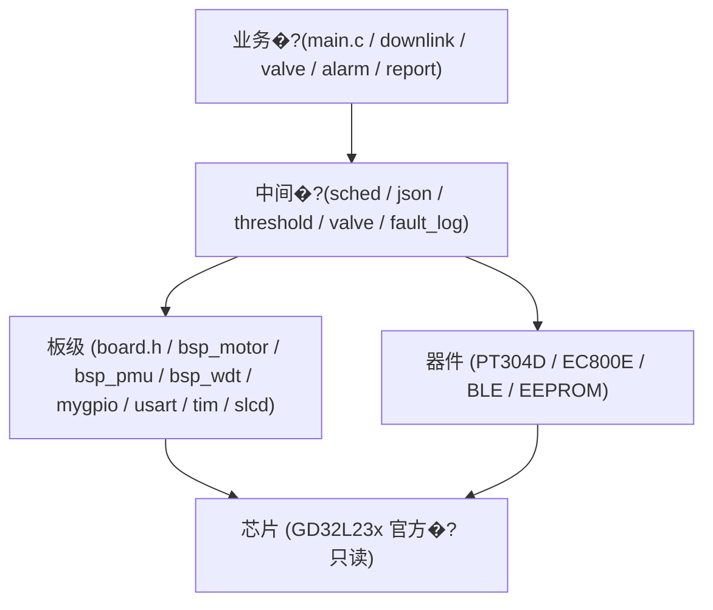

# 架构说明 (当前状�?

> 更新时间: 2026-08-06  |  对应提交: P0 ~ P3 完成

## 1. 分层原则

依赖只向�? 业务不碰寄存�? 驱动不读业务状�? 接口只存在于头文�?



## 2. 模块职责

| 模块 | 职责 | 关键接口 |
|---|---|---|
| board.h | 全工程引脚唯一来源 | BOARD_* �?|
| bsp_motor | 电机使能/方向/停止/限位 | bsp_motor_* |
| bsp_pmu | 深睡/唤醒恢复/时钟/低功耗引�?| bsp_pmu_* |
| bsp_wdt | 软件看门狗接�?+ OTA FWDGT | bsp_wdt_* |
| sched | 事件位寄存器 | sched_event_* |
| valve | ��������ִ�� (����Ԥ��/ȥ��/��ʱ/���ϼ�¼) | valve_execute / valve_get_status |
| fault_log | 复位原因 + 故障环形记录 | fault_log_* |
| sensor_ctx | 传感器全局上下�?| g_sensor |

## 3. 运行模型

- 中断只置事件�?(sched_event_set) 与填充环形缓�?
- 主循环按优先�? 阀�?FSM 轮询 > 调试命令 > 状态机分发 > 休眠决策;
- 深睡�?RTC 健康检�? 失败降级活跃模式;
- 阀门动作事件驱�? 启动即返�? 完成时主循环钩子统一上报.

## 4. 看门狗策�?(维持现状)

- 活跃阶段: 软件看门�?180s, 主循环使�? 长动作协作喂�?
- 深睡: 关闭 (BOR + 复位原因记录兜底);
- OTA: 硬件 FWDGT ~32s.

## 5. 内存与存�?
- 零动态分�? RAM: Code 77.6KB / ZI 21.6KB (32KB �?68%);
- EEPROM: 配置�?0x000-0x4FF, 故障�?0x500-0x59F, 阀门日�?0x5A0, 历史�?0x1000+.

## 6. 测试

- `Tests/` host 单测 (gcc): valve / threshold / json / sensor_buffer;
- `build.ps1` 命令行全量构�?(CI 可调�?;
- CI: host 单测 + GBK 编码契约检�?+ (可�? 自托�?Keil 构建.

## 7. 遗留事项

- 目录已按 App/Middle/BSP/Drivers 分层 (P4-2), 旧的 my_Library 平铺目录已删�?
- downlink �?4G 协议层未抽成独立 proto 模块;
- 调度器仍为最小事件位, 无定时器任务�?
- `.uvoptx` 不纳入版本管�?(含用户调试器配置).

## 8. 目录结构 (P4-2 之后)

```
Pressure_Regulating_Box/
├── App/        # 业务: valve / lcd_ui / led / buzzer / main.h
├── Middle/     # 调度/存储/协议/逻辑: sched / fault_log / threshold /
�?              #   valve / downlink / ota_app / eeprom_config / json...
├── BSP/        # 板级: board.h / mygpio / usart / tim / slcd / adc /
�?              #   bsp_motor / bsp_pmu / bsp_wdt / delay / motor(PWM)
├── Drivers/    # 器件: PT304D / EC800E / BLE / M24M01 / I2C位操�?├── Utilities/
├── Docs/
└── Projects/   # Keil 工程 (uvprojx 已纳入版本管�?
```
