# 架构说明 (当前状态)

> 更新时间: 2026-08-06  |  对应提交: P0 ~ P3 完成

## 1. 分层原则

依赖只向下, 业务不碰寄存器, 驱动不读业务状态, 接口只存在于头文件.

```mermaid
graph TD
    APP["业务层 (main.c / downlink / valve / alarm / report)"]
    MID["中间层 (sched / json / threshold / valve_fsm / fault_log)"]
    BSP["板级 (board.h / bsp_motor / bsp_pmu / bsp_wdt / mygpio / usart / tim / slcd)"]
    DRV["器件 (PT304D / EC800E / BLE / EEPROM)"]
    CHIP["芯片 (GD32L23x 官方库, 只读)"]
    APP --> MID
    MID --> BSP
    MID --> DRV
    BSP --> CHIP
    DRV --> CHIP
```



## 2. 模块职责

| 模块 | 职责 | 关键接口 |
|---|---|---|
| board.h | 全工程引脚唯一来源 | BOARD_* 宏 |
| bsp_motor | 电机使能/方向/停止/限位 | bsp_motor_* |
| bsp_pmu | 深睡/唤醒恢复/时钟/低功耗引脚 | bsp_pmu_* |
| bsp_wdt | 软件看门狗接口 + OTA FWDGT | bsp_wdt_* |
| sched | 事件位寄存器 | sched_event_* |
| valve_fsm | 阀门安全状态机 + 失电日志 | valve_fsm_* |
| fault_log | 复位原因 + 故障环形记录 | fault_log_* |
| sensor_ctx | 传感器全局上下文 | g_sensor |

## 3. 运行模型

- 中断只置事件位 (sched_event_set) 与填充环形缓冲;
- 主循环按优先级: 阀门 FSM 轮询 > 调试命令 > 状态机分发 > 休眠决策;
- 深睡前 RTC 健康检查, 失败降级活跃模式;
- 阀门动作事件驱动: 启动即返回, 完成时主循环钩子统一上报.

## 4. 看门狗策略 (维持现状)

- 活跃阶段: 软件看门狗 180s, 主循环使能, 长动作协作喂狗;
- 深睡: 关闭 (BOR + 复位原因记录兜底);
- OTA: 硬件 FWDGT ~32s.

## 5. 内存与存储

- 零动态分配; RAM: Code 77.6KB / ZI 21.6KB (32KB 的 68%);
- EEPROM: 配置区 0x000-0x4FF, 故障区 0x500-0x59F, 阀门日志 0x5A0, 历史区 0x1000+.

## 6. 测试

- `Tests/` host 单测 (gcc): valve_fsm / threshold / json / sensor_buffer;
- `build.ps1` 命令行全量构建 (CI 可调用);
- CI: host 单测 + GBK 编码契约检查 + (可选) 自托管 Keil 构建.

## 7. 遗留事项

- 目录已按 App/Middle/BSP/Drivers 分层 (P4-2), 旧的 my_Library 平铺目录已删除;
- downlink 与 4G 协议层未抽成独立 proto 模块;
- 调度器仍为最小事件位, 无定时器任务表;
- `.uvoptx` 不纳入版本管理 (含用户调试器配置).

## 8. 目录结构 (P4-2 之后)

```
Pressure_Regulating_Box/
├── App/        # 业务: valve / lcd_ui / led / buzzer / main.h
├── Middle/     # 调度/存储/协议/逻辑: sched / fault_log / threshold /
│               #   valve_fsm / downlink / ota_app / eeprom_config / json...
├── BSP/        # 板级: board.h / mygpio / usart / tim / slcd / adc /
│               #   bsp_motor / bsp_pmu / bsp_wdt / delay / motor(PWM)
├── Drivers/    # 器件: PT304D / EC800E / BLE / M24M01 / I2C位操作
├── Utilities/
├── Docs/
└── Projects/   # Keil 工程 (uvprojx 已纳入版本管理)
```
